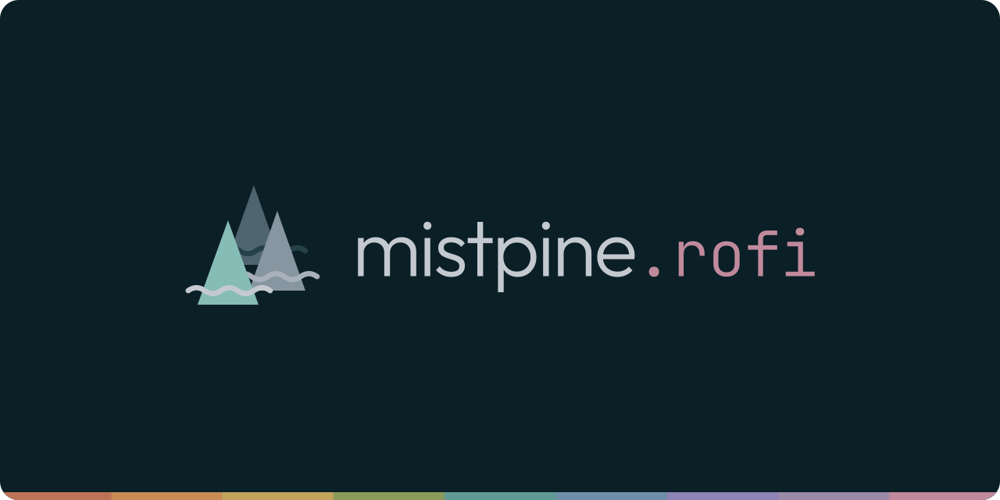
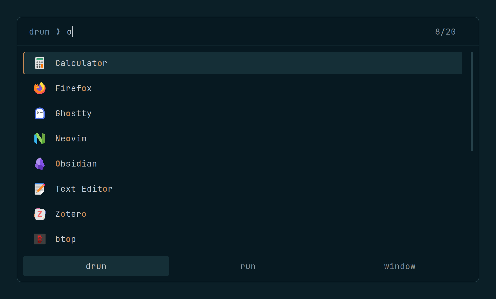
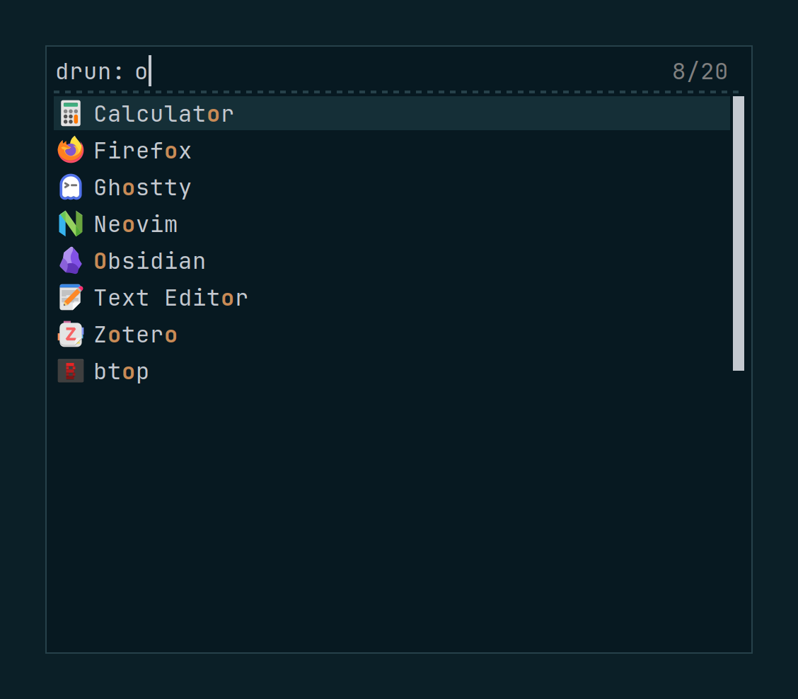
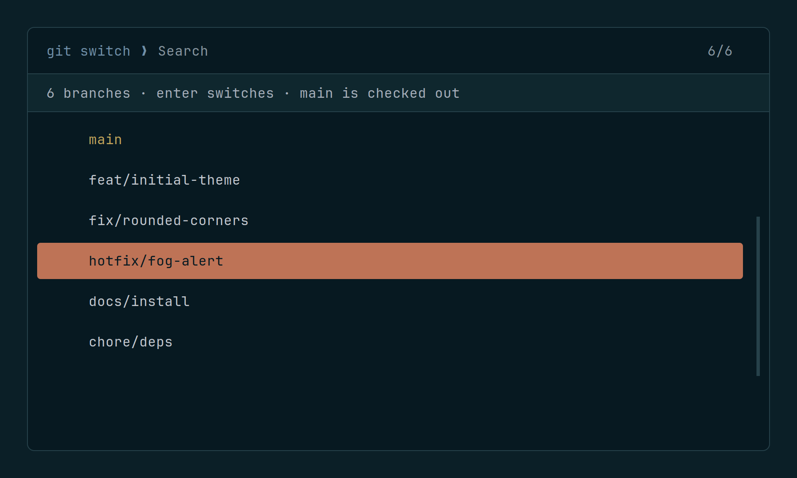

<p align="center">
  
</p>

<p align="center">
  
</p>

**mistpine** for [rofi](https://github.com/davatorium/rofi): cool, misty grays
over a deep blue-green night, with muted, earthy accents. It is the rofi port
of [mistpine](https://github.com/mistpine/mistpine) and follows the
[mistpine spec](https://github.com/mistpine/mistpine/blob/main/docs/spec.md):
every color is the spec's, generated from its palette file and checked against
rofi itself.

- A launcher that looks like mistpine's pickers in Neovim: a recessed window,
  the prompt in the accent, matches in bold orange, the selected row raised
  with an orange caret.
- Active rows (dmenu `-a`, focused windows) in yellow, urgent rows (`-u`) in
  red, filled red when selected. Messages (`-mesg`) on a raised bar.
- Two files: `mistpine.rasi`, the whole theme, and `mistpine-colors.rasinc`,
  the colors alone for your own layout or rofi's.
- Sizes in `em`, so the theme follows your font. Fonts, icons and modes stay
  in your config.
- rofi 1.7.5 and later, including 2.0, on X11 and Wayland.

The screenshots are the real app, rofi 2.0 on sway, and the render fails if a
single theme color comes out different from the spec.

## Install

Requires rofi 1.7.5 or later (`rofi -v`).

The spec loader, color math, banner and pixel checks come from
[@mistpine/port-kit](https://github.com/mistpine/port-kit), shared by every
mistpine port.

```sh
mkdir -p ~/.local/share/rofi/themes
curl -fsSL -o ~/.local/share/rofi/themes/mistpine.rasi \
  https://raw.githubusercontent.com/mistpine/mistpine.rofi/main/themes/mistpine.rasi
```

Then pick `mistpine` in `rofi-theme-selector` (Alt+A accepts it), or put this
line at the end of `~/.config/rofi/config.rasi`, after the `configuration`
block:

```css
@theme "mistpine"
```

For icons and the mode tabs in the screenshot, set them in your config:

```css
configuration {
    show-icons: true;
    modes:      "drun,run,window";
}
```

To follow updates with `git pull` instead, clone this repository and use the
file's full path: `@theme "/path/to/mistpine.rofi/themes/mistpine.rasi"`.

### Rounded corners on X11

On X11, rofi can only draw transparent corners when a compositor such as
picom is running. Without one, the corners show black. Turn the rounding off
there (see Customize). Wayland compositors always composite.

## Colors only

Keep your own layout, or rofi's built-in one, and take only the colors:

```sh
curl -fsSL -o ~/.local/share/rofi/themes/mistpine-colors.rasinc \
  https://raw.githubusercontent.com/mistpine/mistpine.rofi/main/themes/mistpine-colors.rasinc
```

Then import it by its full path at the end of `config.rasi` (after any
`@theme`), or at the top of your own theme:

```css
@import "~/.local/share/rofi/themes/mistpine-colors.rasinc"
```

Keep the full path: rofi 1.7 cannot find a `.rasinc` file by name.



It sets the standard variables most rofi themes read, so it also recolors
themes written in the same style, such as the gruvbox ones that ship with
rofi:

| Variables | mistpine |
| --- | --- |
| `background`, `normal-background`, `alternate-normal-background` | `bg0` `#071921` |
| `foreground`, `normal-foreground`, `alternate-normal-foreground` | `fg3` `#c4c9d0` |
| `border-color`, `separatorcolor`, `scrollbar-handle` | `bg4` `#26414a` |
| `selected-normal-background`, `-foreground` | `bg3` `#152f37`, `fg3` |
| `active-foreground` (and `alternate-`, `selected-`) | `yellow` `#c2a55b`, on `bg0` or `bg3` |
| `urgent-foreground` (and `alternate-`) | `red` `#be7356` on `bg0` |
| `selected-urgent-background`, `-foreground` | `red`, `bg0` |
| `highlight` (matched characters) | bold `orange` `#c98b56` |

Your own layout can also use the palette as `mistpine-bg0` …
`mistpine-bright-cyan`, and mistpine's roles: `mistpine-prompt` (blue),
`mistpine-muted` (`fg1`), `mistpine-caret` and `mistpine-match` (orange),
`mistpine-message-background` and `-foreground` (`bg2`, `fg2`) and
`mistpine-error` (red).

## Customize

Override the theme after the `@theme` line in `config.rasi`:

```css
@theme "mistpine"

* {
    mistpine-width:  50em;  /* default 40em */
    mistpine-radius: 0;     /* square corners, for X11 without a compositor */
}

listview {
    lines: 10;              /* default 8 */
}
```

Set the font in `configuration { font: "JetBrains Mono 12"; }`: every size
in the theme follows it.

## Screenshots



## Development

Requires Node 24+, pnpm (`corepack enable`) and Docker.

```sh
pnpm install
pnpm generate  # themes/ from the mistpine spec and src/layout.rasi
pnpm check     # fail if themes/ is out of date
pnpm verify    # rofi 1.7.5 and 2.0 load both files and resolve every color to the spec
pnpm render    # README screenshots from real rofi, with pixel checks
pnpm banner    # assets/banner.svg and the social preview (Chromium)
pnpm lint && pnpm typecheck
```

Never edit `themes/` by hand. The layout lives in `src/layout.rasi`, which
may use colors only through `var()`. `scripts/generate.ts` maps each rofi
variable to a spec token, reads the colors from
[`palette/mistpine.json`](https://github.com/mistpine/mistpine/blob/main/palette/mistpine.json)
(from `$MISTPINE_DIR`, `../mistpine` or GitHub), and writes the colors file
and the single-file theme. It also checks the layout against the widgets and
properties rofi 1.7.5 knows (rofi ignores unknown ones without a word) and
requires 4.5:1 for every text color on every background it can sit on.

`pnpm verify` and `pnpm render` run rofi in Docker: Ubuntu 24.04 for rofi
1.7.5, Ubuntu 26.04 for rofi 2.0 (`scripts/render/Dockerfile`). verify fails
on any rofi warning, since rofi exits 0 even when it cannot parse a theme.
render shows each scene on X11 (Xvfb) with both versions and on Wayland
(headless sway) with 2.0, checks the pixels, and crops the Wayland shots for
the README.

## Credits

- Designed in [themes.utimura.io](https://themes.utimura.io).
- [Outfit](https://github.com/Outfitio/Outfit-Fonts) and
  [JetBrains Mono](https://github.com/JetBrains/JetBrainsMono) in the banner.
  The screenshots use JetBrains Mono and the
  [Papirus](https://github.com/PapirusDevelopmentTeam/papirus-icon-theme)
  icons.

## License

[MIT](LICENSE).
